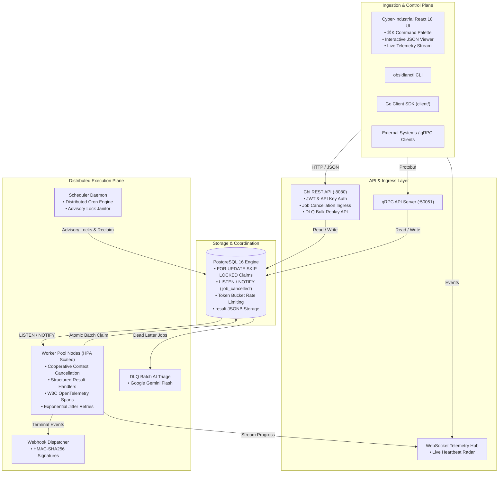

# Obsidian — Distributed Job Scheduling Platform

[](https://github.com/AdeshDeshmukh/obsidian/actions/workflows/ci.yml)
[](https://golang.org)
[](https://www.postgresql.org)
[](https://kubernetes.io)
[](https://opentelemetry.io)
[](https://grpc.io)
[](docs/DEPLOYMENT.md)

Obsidian is an enterprise-grade, highly resilient distributed background job scheduling and execution engine. Built with **Go** for high concurrency and **PostgreSQL 16** for atomic locking guarantees, it provides a comprehensive developer ecosystem featuring a **Cyber-Industrial React 18 / Vite real-time dashboard** with a `⌘K` Command Palette, an administrative CLI (`obsidianctl`), a native Go SDK (`client/`), dual **REST + gRPC** APIs, and cloud-native **Kubernetes HPA** autoscaling.

---

## ⚡ Quick Start (1-Command Local Production Fleet)

Launch the complete production-grade fleet locally (PostgreSQL, Core API, Worker Pool, Distributed Scheduler, Auto-Bootstrapping Seeder, and Prometheus):

```bash
docker compose -f docker-compose.prod.yml --profile demo up --build -d
```

### Access Points:
- **Interactive Web Dashboard:** [http://localhost:5173](http://localhost:5173)
  - **Email:** `demo@obsidian.local`
  - **Password:** `demopassword123`
  *(Pre-seeded with active queues, live traffic, and simulated failures for DLQ triage)*
- **REST & WebSocket API:** [http://localhost:8080](http://localhost:8080)
- **Prometheus Metrics:** [http://localhost:8080/metrics](http://localhost:8080/metrics)
- **PostgreSQL 16:** `localhost:5432` (User: `postgres`, Password: `obsidian`)

---

## ☁️ Zero-Cost Cloud Deployment (100% Free Forever)

Obsidian can be deployed entirely free without a credit card using:
1. **Database:** [Neon.tech](https://neon.tech) — Serverless PostgreSQL 16 (0.5 GB free storage, native `SKIP LOCKED` and `LISTEN/NOTIFY`).
2. **Backend Services:** [Render.com](https://render.com) — Free Docker Web Service & Background Worker defined in [`render.yaml`](render.yaml).
3. **Frontend Dashboard:** [Vercel](https://vercel.com) — Free global edge CDN defined in [`dashboard/vercel.json`](dashboard/vercel.json).

👉 **[Read the Complete Step-by-Step Deployment Guide](docs/DEPLOYMENT.md)**

---

## 🏗️ System Architecture



---

## 🚀 Key Architectural Capabilities

### 1. Core Concurrency & Reliability Invariants
- **Atomic Job Claims via `FOR UPDATE SKIP LOCKED`**: Competing worker routines atomically poll queues without double-claims or lock-wait contention ([ADR 001](docs/adr/001-atomic-claims-skip-locked.md)).
- **Heartbeat Lease Recovery**: Workers maintain heartbeats. If a worker node crashes mid-execution, its lease expires, and the scheduler janitor reclaims abandoned tasks for at-least-once execution.
- **DAG Workflow Dependency Resolution**: Complex task graphs with dependency prerequisites (`depends_on`). The worker claim query uses a non-blocking `NOT EXISTS` predicate, preventing child jobs from running until parents finish.
- **Cycle Detection (Recursive CTE)**: Graph cycles are validated and blocked at job creation time via SQL recursive common table expressions.
- **Exponential Backoff with Decorrelated Jitter**: Full randomized jitter on job retries to eliminate "thundering herd" spikes against dependent databases.
- **Queue State Machine**: Queues transition seamlessly between `active`, `paused`, `draining` (clears in-flight jobs then halts), and `maintenance`.

### 2. Cooperative In-Flight Job Cancellation (`LISTEN / NOTIFY`)
- Instantly cancel long-running, in-flight jobs via `POST /api/jobs/{jobId}/cancel` or the UI.
- Emits a PostgreSQL `NOTIFY job_cancelled, '<job_id>'` payload.
- The executing worker intercepts the notification, fires Go's `context.CancelFunc`, gracefully aborts the handler, marks the job as `cancelled`, and frees worker concurrency immediately.

### 3. Structured Job Output & Result Storage (`result JSONB`)
- Workers can return typed structured payloads upon completion (e.g. computation results, exported S3 file URLs, third-party payment tokens).
- Handlers register via `RegisterResultHandler(jobType, func(ctx, payload) (interface{}, error))`.
- Persisted as native `JSONB` in both the `jobs` and `job_executions` tables, accessible via REST, gRPC, the Go SDK, and visually formatted in the dashboard modal.

### 4. Dead Letter Queue (DLQ) & Bulk Replay
- When retries are exhausted, jobs are safely isolated into `dead_letter_queue` with error details and attempt history.
- **Bulk Replay API:** Replay thousands of DLQ jobs back into active queues with a single call (`POST /api/dlq/replay`) or CLI command (`obsidianctl dlq replay`).
- **AI Fleet Triage:** One-click root-cause analysis clusters similar failures, diagnoses the failure patterns, and suggests fixes via Google Gemini Flash.

### 5. Composite Queue Health Scoring (0–100, Grades A–F)
- Real-time diagnostic endpoint (`GET /api/queues/{queueId}/health`) calculating composite queue health based on 1-hour DLQ rate, execution failure rate, and pending backlog depth ([ADR 004](docs/adr/004-composite-queue-health-scoring.md)).

### 6. High-Performance gRPC API & Protobuf
- Native protobuf specification defined in `proto/obsidian.proto`.
- Fully typed gRPC service (`EnqueueJob`, `GetJob`, `CancelJob`, `ListQueues`) running side-by-side with the REST API.
- Re-generate protobuf Go stubs anytime via `make proto`.

### 7. OpenTelemetry Distributed Tracing (CNCF Standards)
- End-to-end W3C trace context propagation across API ingestion, queue storage, and worker execution (`ExecuteJob`).
- Exports spans directly to Jaeger, Tempo, or OpenTelemetry Collector ([ADR 002](docs/adr/002-distributed-tracing-opentelemetry.md)).

### 8. Distributed Token-Bucket Rate Limiting
- Per-queue rate limiting enforced directly inside PostgreSQL transactions without external Redis dependencies ([ADR 003](docs/adr/003-token-bucket-rate-limiting.md)).
- Dynamically configurable via `PUT /api/queues/{queueId}/rate-limit` or `obsidianctl`.

---

## 🛠️ Developer Tooling & Client SDKs

### `obsidianctl` Admin CLI
Build and use the official CLI tool:
```bash
# Build the binary
go build -o bin/obsidianctl ./cmd/obsidianctl

# Inspect queues
./bin/obsidianctl queue ls

# Pause or resume a queue
./bin/obsidianctl queue pause <queue-id>
./bin/obsidianctl queue resume <queue-id>

# Replay all DLQ jobs
./bin/obsidianctl dlq replay

# Inspect active cluster worker nodes
./bin/obsidianctl workers ls
```

### Go Client SDK (`client/`)
Integrate Obsidian directly into your Go services:
```go
package main

import (
	"context"
	"fmt"
	"obsidian/client"
)

func main() {
	c := client.NewClient("http://localhost:8080", "your-jwt-token")

	// Enqueue a background task
	job, err := c.Enqueue(context.Background(), "default-queue", "compute", map[string]interface{}{
		"a": 40,
		"b": 2,
	}, 10)
	if err != nil {
		panic(err)
	}

	fmt.Printf("Job enqueued successfully: %s\n", job.ID)

	// Fetch job status and structured result
	status, err := c.GetJob(context.Background(), job.ID)
	if err == nil && status.Result != nil {
		fmt.Printf("Job completed with result: %+v\n", status.Result)
	}
}
```

---

## ☸️ Cloud-Native Deployment & Kubernetes

### Kubernetes Manifests & Worker HPA
Kubernetes configurations are organized under `k8s/` and ready for Kustomize:
```bash
# Deploy all components to the 'obsidian' namespace
kubectl apply -k k8s/

# Automatic horizontal pod autoscaling based on worker CPU utilization
kubectl get hpa -n obsidian
```

### Production Docker Images
Production images are packaged using minimal multi-stage Dockerfiles:
- `docker/api.Dockerfile`
- `docker/worker.Dockerfile`
- `docker/scheduler.Dockerfile`
- `docker/seeder.Dockerfile`

---

## 🧪 Testing & Verification

### Full Automated Test Suite
Run 100% automated test coverage across all packages (zero database required for unit suites):
```bash
make test
```
```bash
ok      obsidian/client                         (Unit tests)
ok      obsidian/cmd/obsidianctl                (CLI command tests)
ok      obsidian/cmd/seeder                     (Traffic generator tests)
ok      obsidian/internal/ai                    (AI DLQ triage tests)
ok      obsidian/internal/api/handlers          (REST handlers)
ok      obsidian/internal/api/middleware        (JWT auth & RBAC)
ok      obsidian/internal/config                (Env config loader)
ok      obsidian/internal/grpc                  (gRPC in-memory bufconn tests)
ok      obsidian/internal/metrics               (Prometheus & Queue health tests)
ok      obsidian/internal/queue                 (Retry backoff & Token bucket)
ok      obsidian/internal/telemetry             (OTel tracing spans)
ok      obsidian/internal/webhook               (HMAC dispatch & retries)
ok      obsidian/internal/worker                (Executor & Progress reporting)
```

### Chaos Failover Verification
Demonstrate worker crash recovery, heartbeat expiration, and automatic task reclamation:
```bash
make chaos-demo
```
- Recorded execution proof log: [Chaos Recovery Log](docs/chaos-demo-output.log)

---

## 📚 Architecture Decision Records (ADRs)

Key architectural decisions and design trade-offs are documented under [`docs/adr/`](docs/adr/):
- **[ADR 001: Atomic Job Claims via PostgreSQL FOR UPDATE SKIP LOCKED](docs/adr/001-atomic-claims-skip-locked.md)**
- **[ADR 002: Distributed Tracing with OpenTelemetry and W3C Context Propagation](docs/adr/002-distributed-tracing-opentelemetry.md)**
- **[ADR 003: Distributed Token-Bucket Rate Limiting per Queue](docs/adr/003-token-bucket-rate-limiting.md)**
- **[ADR 004: Composite Queue Health Scoring and Diagnostics](docs/adr/004-composite-queue-health-scoring.md)**

Additional reference documents:
- **[Cloud Deployment Guide](docs/DEPLOYMENT.md)**
- **[System Design Decisions](docs/design-decisions.md)**
- **[REST & gRPC Endpoint Specifications](docs/api-spec.md)**
- **[Postman API Collection](docs/postman-collection.json)**
