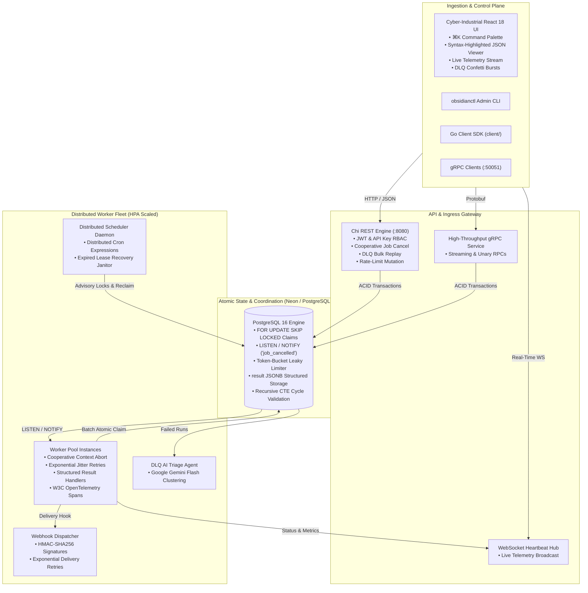

<div align="center">

# ⚡ OBSIDIAN
### Enterprise Distributed Job Scheduling & Real-Time Orchestration Platform

*Engineered with Go 1.24+ concurrency, PostgreSQL 16 atomic locks, distributed DAG orchestration, and a cyber-industrial real-time telemetry console.*

[](https://obsidian-pink-gamma.vercel.app/)
[](https://obsidian-api-u3mb.onrender.com)
[](https://neon.tech)

<br/>

[](https://github.com/AdeshDeshmukh/obsidian/actions)
[](https://golang.org)
[](https://www.postgresql.org)
[](https://kubernetes.io)
[](https://opentelemetry.io)
[](https://grpc.io)
[](LICENSE)

<br/>

[**Explore Live Dashboard**](https://obsidian-pink-gamma.vercel.app/) • [**System Architecture**](#-system-architecture) • [**Key Features**](#-core-capabilities) • [**Quick Start**](#-quick-start) • [**CLI Guide**](#-obsidianctl-admin-cli) • [**ADRs**](#-architecture-decision-records-adrs)

</div>

---

## 🌟 Overview

**Obsidian** is an enterprise-grade, zero-dependency distributed task orchestration and background execution engine. Built from first principles to solve high-throughput workload coordination without heavyweight external brokers like Redis or Kafka, Obsidian leverages **PostgreSQL 16's atomic locking (`FOR UPDATE SKIP LOCKED`)** and **cooperative pub/sub cancellation (`LISTEN / NOTIFY`)** to guarantee **strict at-least-once execution, zero double-claims, and sub-millisecond dispatching**.

Paired with a high-fidelity **Cyber-Industrial React 18 & Vite dashboard**, Obsidian gives platform and infrastructure engineers deep visibility into fleet health, active worker leases, live WebSocket telemetry, distributed DAG dependency graphs, and automated Dead-Letter Queue (DLQ) AI root-cause analysis powered by Google Gemini.

### 🌐 Live Production Deployment
Experience the fully orchestrated cloud fleet live without any installation:
- **Frontend Console:** [https://obsidian-pink-gamma.vercel.app/](https://obsidian-pink-gamma.vercel.app/)
- **Backend API:** `https://obsidian-api-u3mb.onrender.com`
- **Pre-Seeded Fleet Credentials:** Click `⚡ Fill Demo Credentials` on the login screen, or enter:
  - **Email:** `demo@obsidian.local`
  - **Password:** `demopassword123`

---

## 🏗️ System Architecture



---

## ✨ Core Capabilities

### 1. 🔒 Concurrency Invariants & Atomic Claims
- **Zero Double-Claims (`FOR UPDATE SKIP LOCKED`)**: Competing worker routines across different nodes poll queues concurrently with zero lock contention and zero duplicate claims ([ADR 001](docs/adr/001-atomic-claims-skip-locked.md)).
- **Heartbeat Lease Recovery**: Workers maintain periodic heartbeat leases. If a worker pod crashes mid-execution, its lease lapses and the scheduler automatically reclaims and reassigns abandoned jobs for zero work loss.
- **Queue State Machine**: Queues transition safely between `active`, `paused`, `draining` (completes in-flight work before stopping), and `maintenance`.

### 2. ⚡ Cooperative In-Flight Job Cancellation (`LISTEN / NOTIFY`)
- Trigger cancellation at any time via `POST /api/jobs/{jobId}/cancel`, `obsidianctl`, or the UI.
- Instantly fires a PostgreSQL `NOTIFY job_cancelled, '<job_id>'` broadcast.
- The active worker node intercepts the notification within milliseconds, cancels Go's `context.Context`, gracefully cleans up resources, marks the job as `cancelled`, and frees execution concurrency immediately.

### 3. 📦 Structured Job Output & Result Storage (`result JSONB`)
- Background jobs are not just success/failure—they return typed structured data payloads (e.g. S3 file download URLs, AI inference matrices, payment confirmation tokens).
- Handlers register structured execution routines via:
  ```go
  worker.RegisterResultHandler("compute", func(ctx context.Context, payload map[string]interface{}) (interface{}, error) {
      return map[string]interface{}{"result": 42, "status": "completed"}, nil
  })
  ```
- Persisted in native PostgreSQL `JSONB` across both `jobs` and `job_executions` tables, rendered with copyable syntax-highlighted viewers on the frontend.

### 4. 🔀 Distributed DAG Workflow Engine
- Execute complex job trees with non-blocking dependency resolution (`depends_on`).
- Workers use a high-efficiency `NOT EXISTS` predicate query that prevents child jobs from executing until every parent completes successfully.
- **SQL Cycle Detection**: Circular dependency graphs are identified and rejected at ingestion time using SQL Recursive Common Table Expressions (CTEs).

### 5. 🤖 Dead-Letter Queue (DLQ) & Gemini AI Triage
- Failed jobs with exhausted retries are isolated in a dead-letter state with complete stack traces and execution attempts preserved.
- **One-Click Bulk Replay**: Replay thousands of DLQ jobs back into circulation with a single API call or CLI command.
- **Autonomous AI Root-Cause Analysis**: Clusters high-volume error traces, diagnoses environmental and database failures, and suggests actionable remediation steps via Google Gemini Flash.

### 6. 🛡️ In-Database Token-Bucket Rate Limiting
- Per-queue rate limiting enforced atomically inside PostgreSQL transactions without external Redis caches ([ADR 003](docs/adr/003-token-bucket-rate-limiting.md)).
- Dynamically configurable burst caps and refill rates via REST, CLI, or the UI.

### 7. 🩺 Composite Health Scoring (0–100, Grades A–F)
- Real-time diagnostic endpoint (`GET /api/queues/{queueId}/health`) calculating composite queue health based on 1-hour DLQ rate, execution failure rate, and pending backlog depth ([ADR 004](docs/adr/004-composite-queue-health-scoring.md)).

### 8. 🔭 OpenTelemetry & CNCF Observability
- Distributed tracing with full W3C trace context propagation across REST API, database storage, and worker execution threads ([ADR 002](docs/adr/002-distributed-tracing-opentelemetry.md)).
- Native Prometheus `/metrics` endpoint exporting queue depths, claim latencies, and worker pool saturations.

---

## 🎨 Cyber-Industrial Dashboard Experience

The Obsidian Console is built with **React 18, Vite, Framer Motion, and TailwindCSS**, engineered with high-density telemetry aesthetics and subtle human-psychology design tokens:

| Feature | Description | Shortcut / Behavior |
| :--- | :--- | :--- |
| **⌘K Command Palette** | Instant fuzzy search across jobs, queues, workers, and actions | <kbd>⌘</kbd> + <kbd>K</kbd> or <kbd>Ctrl</kbd> + <kbd>K</kbd> |
| **Interactive JSON Viewer** | Formatted JSON payloads and structured results with line numbers | One-click copy with toast confirmation |
| **Split-Screen Auth** | Warm cream and sandstone credentials panel paired with obsidian telemetry showcase | One-click `⚡ Fill Demo Credentials` |
| **Live Telemetry Stream** | Heartbeat radar and real-time WebSocket job lifecycle events | Automatic reconnection & backoff |
| **DLQ Micro-Bursts** | Celebratory confetti micro-bursts upon successful DLQ replay or job enqueue | Powered by `canvas-confetti` |

---

## ⚡ Quick Start

### 1-Command Local Production Fleet (Docker Compose)
Spin up the complete production-grade fleet locally including PostgreSQL, API, Worker Pool, Scheduler, Auto-Bootstrapping Seeder, and Prometheus:

```bash
docker compose -f docker-compose.prod.yml --profile demo up --build -d
```

### Access Points
- **Web Dashboard:** [http://localhost:5173](http://localhost:5173) (User: `demo@obsidian.local` / Pass: `demopassword123`)
- **REST API & WebSockets:** [http://localhost:8080](http://localhost:8080)
- **gRPC Server:** `localhost:50051`
- **Prometheus Metrics:** [http://localhost:8080/metrics](http://localhost:8080/metrics)
- **PostgreSQL 16:** `localhost:5432` (`postgres` / `obsidian`)

---

## ☁️ Zero-Cost Cloud Deployment (100% Free Forever)

Deploy your own complete Obsidian cluster to the cloud without paying a cent or entering a credit card:

```
┌─────────────────┐       ┌─────────────────┐       ┌─────────────────┐
│     VERCEL      │ ----> │   RENDER.COM    │ ----> │    NEON.TECH    │
│  React 18 / SPA │       │   Go API + Pool │       │  PostgreSQL 16  │
│  Global Edge    │  WSS  │  Docker Engine  │  TCP  │  Serverless DB  │
└─────────────────┘       └─────────────────┘       └─────────────────┘
```

1. **Database:** [Neon.tech](https://neon.tech) — Serverless PostgreSQL 16 (0.5 GB free storage, native `SKIP LOCKED` and `LISTEN/NOTIFY`).
2. **Backend Services:** [Render.com](https://render.com) — Free Docker Web Service running both API and embedded worker pool (`render.yaml`).
3. **Frontend Dashboard:** [Vercel](https://vercel.com) — Global edge CDN with automatic SPA client routing (`dashboard/vercel.json`).

📖 **[Read the Step-by-Step Cloud Deployment Guide](docs/DEPLOYMENT.md)**

---

## 🛠️ `obsidianctl` Admin CLI

Obsidian ships with a standalone, compiled administrative CLI for terminal-first operators:

```bash
# Build the binary
go build -o bin/obsidianctl ./cmd/obsidianctl

# Inspect all queues and backlog depths
./bin/obsidianctl queue ls

# Pause or resume queue consumption
./bin/obsidianctl queue pause <queue-id>
./bin/obsidianctl queue resume <queue-id>

# Replay all DLQ jobs
./bin/obsidianctl dlq replay

# Inspect active cluster worker nodes and heartbeats
./bin/obsidianctl workers ls
```

---

## 💻 Go Client SDK (`client/`)

Embed job scheduling directly into your Go microservices:

```go
package main

import (
	"context"
	"fmt"
	"obsidian/client"
)

func main() {
	// Initialize authenticated Obsidian client
	c := client.NewClient("https://obsidian-api-u3mb.onrender.com", "your-jwt-or-api-key")

	// Enqueue a background compute job with payload and max retries
	job, err := c.Enqueue(context.Background(), "email-queue", "compute", map[string]interface{}{
		"task": "render_invoice",
		"invoice_id": 98412,
		"currency": "USD",
	}, 5)
	if err != nil {
		panic(err)
	}

	fmt.Printf("Job enqueued successfully: %s\n", job.ID)

	// Fetch job status and structured result
	status, err := c.GetJob(context.Background(), job.ID)
	if err == nil && status.Result != nil {
		fmt.Printf("Job output result: %+v\n", status.Result)
	}
}
```

---

## 🧪 Testing & Verification

Obsidian features comprehensive unit, integration, and chaos test suites:

```bash
# Run 100% automated test suite
make test
```

```
ok      obsidian/client                         (Go Client SDK)
ok      obsidian/cmd/obsidianctl                (CLI Command Tests)
ok      obsidian/cmd/seeder                     (Fleet Bootstrap & Seeder)
ok      obsidian/internal/ai                    (Gemini AI DLQ Triage)
ok      obsidian/internal/api/handlers          (REST Handlers & Ingress)
ok      obsidian/internal/api/middleware        (JWT Auth & RBAC)
ok      obsidian/internal/config                (Environment Config Loader)
ok      obsidian/internal/grpc                  (gRPC in-memory bufconn)
ok      obsidian/internal/metrics               (Prometheus & Queue Health)
ok      obsidian/internal/queue                 (Retry Backoff & Token Bucket)
ok      obsidian/internal/telemetry             (OTel Spans & W3C Prop)
ok      obsidian/internal/webhook               (HMAC Dispatch & Retries)
ok      obsidian/internal/worker                (Executor, Result Handler & Progress)
```

### Chaos Failover Verification
Demonstrate worker crash recovery, heartbeat expiration, and automatic task reclamation under failure conditions:

```bash
make chaos-demo
```
- Recorded execution proof log: [Chaos Recovery Log](docs/chaos-demo-output.log)

---

## 📚 Architecture Decision Records (ADRs)

Key architectural decisions, trade-offs, and invariants are documented in detail:

- **[ADR 001: Atomic Job Claims via PostgreSQL FOR UPDATE SKIP LOCKED](docs/adr/001-atomic-claims-skip-locked.md)**
- **[ADR 002: Distributed Tracing with OpenTelemetry and W3C Context Propagation](docs/adr/002-distributed-tracing-opentelemetry.md)**
- **[ADR 003: Distributed Token-Bucket Rate Limiting per Queue](docs/adr/003-token-bucket-rate-limiting.md)**
- **[ADR 004: Composite Queue Health Scoring and Diagnostics](docs/adr/004-composite-queue-health-scoring.md)**

### Technical Documentation
- **[Cloud Deployment Guide](docs/DEPLOYMENT.md)**
- **[System Design Decisions](docs/design-decisions.md)**
- **[REST & gRPC Endpoint Specifications](docs/api-spec.md)**
- **[Postman API Collection](docs/postman-collection.json)**

---

<div align="center">

Crafted with high-performance Go, PostgreSQL, and modern UI telemetry principles.  
Released under the [MIT License](LICENSE).

</div>
