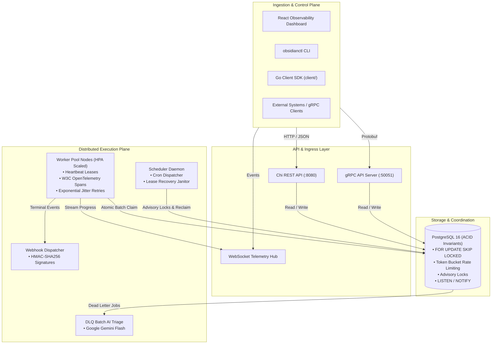

# Obsidian — Distributed Job Scheduling Platform

[](https://github.com/AdeshDeshmukh/obsidian/actions/workflows/ci.yml)
[](https://golang.org)
[](https://www.postgresql.org)
[](https://kubernetes.io)
[](https://opentelemetry.io)
[](https://grpc.io)

Obsidian is a production-grade, highly resilient distributed background job scheduling and execution engine. Built with **Go** for high concurrency and **PostgreSQL** for atomic locking guarantees, it provides a comprehensive developer ecosystem featuring a **React 18 / Vite real-time dashboard**, an administrative CLI (`obsidianctl`), a native Go SDK (`client/`), dual **REST + gRPC** APIs, and cloud-native **Kubernetes HPA** autoscaling.

---

## ⚡ Quick Start

### 1. Environment & Database Setup
```bash
# Clone and configure environment
cp .env.example .env

# Start PostgreSQL via Docker Compose
make db-up

# Apply database migrations
PGPASSWORD=obsidian psql -h localhost -U postgres -d obsidian -f internal/db/migrations/001_init.sql
```

### 2. Launch Services (Local Dev)
```bash
make run-api        # REST API Server on http://localhost:8080 (Metrics on /metrics)
make run-scheduler  # Cron Dispatcher & Lease Recovery Janitor
make run-worker     # High-Concurrency Worker Node Daemon
make run-seeder     # Automated realistic job traffic generator
make run-dashboard  # React 18 Observability Dashboard on http://localhost:5173
```

---

## 🏗️ System Architecture



---

## 🚀 Key Architectural Capabilities

### 1. Core Concurrency & Reliability Invariants
- **Atomic Job Claims via `FOR UPDATE SKIP LOCKED`**: Competing worker routines atomically poll queues without double-claims or lock-wait contention ([ADR 001](docs/adr/001-atomic-claims-skip-locked.md)).
- **Heartbeat Lease Recovery**: Workers maintain heartbeats. If a worker node crashes mid-execution, its lease expires, and the scheduler janitor reclaims abandoned tasks for at-least-once execution.
- **DAG Workflow Dependency Resolution**: Complex task graphs with dependency prerequisites (`depends_on`). The worker claim query uses a non-blocking `NOT EXISTS` predicate, preventing child jobs from running until parents finish.
- **Cycle Detection (Recursive CTE)**: Graph cycles are validated and blocked at job creation time via SQL recursive common table expressions.
- **Exponential Backoff with Decorrelated Jitter**: Full randomized jitter on job retries to eliminate "thundering herd" spikes against dependent databases.
- **Queue State Machine**: Queues transition seamlessly between `active`, `paused`, `draining` (clears in-flight jobs then halts), and `maintenance`.

### 2. High-Performance gRPC API & Protobuf
- Native protobuf specification defined in `proto/obsidian.proto`.
- Fully typed gRPC service (`EnqueueJob`, `GetJob`, `CancelJob`, `ListQueues`) running side-by-side with the REST API.
- Re-generate protobuf Go stubs anytime via `make proto`.

### 3. OpenTelemetry Distributed Tracing (CNCF Standards)
- End-to-end W3C trace context propagation across API ingestion, queue storage, and worker execution (`ExecuteJob`).
- Exports spans directly to Jaeger, Tempo, or OpenTelemetry Collector ([ADR 002](docs/adr/002-distributed-tracing-opentelemetry.md)).

### 4. Distributed Token-Bucket Rate Limiting
- Per-queue rate limiting enforced directly inside PostgreSQL transactions without external Redis dependencies ([ADR 003](docs/adr/003-token-bucket-rate-limiting.md)).
- Dynamically configurable via `PUT /api/queues/{queueId}/rate-limit` or `obsidianctl`.

### 5. Composite Queue Health Scoring (0–100, Grades A–F)
- Real-time diagnostic endpoint (`GET /api/queues/{queueId}/health`) calculating composite queue health based on 1-hour DLQ rate, execution failure rate, and pending backlog depth ([ADR 004](docs/adr/004-composite-queue-health-scoring.md)).

### 6. HMAC Webhooks & AI Failure Triage
- **HMAC-SHA256 Webhooks**: Dispatches verifiable cryptographic signatures (`X-Obsidian-Signature`) to external endpoints upon job terminal states.
- **DLQ AI Batch Triage**: Aggregates fleet-level dead-letter failures, prompts Google Gemini 1.5 Flash with batched error context, and returns ranked root causes with remediation actions.

---

## 🛠️ Developer Tooling & Client SDKs

### `obsidianctl` Admin CLI
Build and use the official CLI tool:
```bash
# Build the binary
go build -o bin/obsidianctl ./cmd/obsidianctl

# Inspect queues
./bin/obsidianctl queue ls

# Pause or resume a queue
./bin/obsidianctl queue pause <queue-id>
./bin/obsidianctl queue resume <queue-id>

# Retry failed jobs in DLQ
./bin/obsidianctl jobs retry <job-id>

# Inspect active cluster worker nodes
./bin/obsidianctl workers ls
```

### Go Client SDK (`client/`)
Integrate Obsidian directly into your Go services:
```go
package main

import (
	"context"
	"fmt"
	"obsidian/client"
)

func main() {
	c := client.NewClient("http://localhost:8080", "your-jwt-token")

	// Enqueue a background task
	job, err := c.Enqueue(context.Background(), "default-queue", "send_welcome_email", map[string]interface{}{
		"email": "user@example.com",
		"name":  "Alex",
	}, 10)
	if err != nil {
		panic(err)
	}

	fmt.Printf("Job enqueued successfully: %s\n", job.ID)
}
```

---

## ☸️ Cloud-Native Deployment & Kubernetes

### Production Multi-Stage Containers
Production images are packaged using minimal multi-stage Dockerfiles:
- `docker/api.Dockerfile`
- `docker/worker.Dockerfile`
- `docker/scheduler.Dockerfile`
- `docker/seeder.Dockerfile`

Run full production stack with Prometheus:
```bash
docker compose -f docker-compose.prod.yml up -d
```

### Kubernetes Manifests & Worker HPA
Kubernetes configurations are organized under `k8s/` and ready for Kustomize:
```bash
# Deploy all components to the 'obsidian' namespace
kubectl apply -k k8s/

# Automatic horizontal pod autoscaling based on worker CPU utilization
kubectl get hpa -n obsidian
```

### Cloud Platforms (Railway / Vercel)
- **Railway**: Fully configured via `railway.toml` with multi-service topologies (API, Worker, Scheduler).
- **Vercel**: Deploy the React observability dashboard with zero configuration (`cd dashboard && vercel`).

---

## 🧪 Testing & Verification

### Full Automated Test Suite
Run 100% automated test coverage across all packages (zero database required for unit suites):
```bash
make test
```
```bash
ok      obsidian/client                         (Unit tests)
ok      obsidian/cmd/obsidianctl                (CLI command tests)
ok      obsidian/cmd/seeder                     (Traffic generator tests)
ok      obsidian/internal/ai                    (AI DLQ triage tests)
ok      obsidian/internal/api/handlers          (REST handlers)
ok      obsidian/internal/api/middleware        (JWT auth & RBAC)
ok      obsidian/internal/config                (Env config loader)
ok      obsidian/internal/grpc                  (gRPC in-memory bufconn tests)
ok      obsidian/internal/metrics               (Prometheus & Queue health tests)
ok      obsidian/internal/queue                 (Retry backoff & Token bucket)
ok      obsidian/internal/telemetry             (OTel tracing spans)
ok      obsidian/internal/webhook               (HMAC dispatch & retries)
ok      obsidian/internal/worker                (Executor & Progress reporting)
```

### Chaos Failover Verification
Demonstrate worker crash recovery, heartbeat expiration, and automatic task reclamation:
```bash
make chaos-demo
```
- Recorded execution proof log: [Chaos Recovery Log](docs/chaos-demo-output.log)

### High-Throughput Load Testing (k6)
Benchmark queue claim throughput under heavy concurrency:
```bash
k6 run load-test/k6-claim-throughput.js --env API_URL=http://localhost:8080 --env QUEUE_ID=<your-queue-id>
```
- Benchmark report & P99 latency: [Load Test Results](docs/load-test-results.md)

---

## 📚 Architecture Decision Records (ADRs)

Key architectural decisions and design trade-offs are documented under [`docs/adr/`](docs/adr/):
- **[ADR 001: Atomic Job Claims via PostgreSQL FOR UPDATE SKIP LOCKED](docs/adr/001-atomic-claims-skip-locked.md)**
- **[ADR 002: Distributed Tracing with OpenTelemetry and W3C Context Propagation](docs/adr/002-distributed-tracing-opentelemetry.md)**
- **[ADR 003: Distributed Token-Bucket Rate Limiting per Queue](docs/adr/003-token-bucket-rate-limiting.md)**
- **[ADR 004: Composite Queue Health Scoring and Diagnostics](docs/adr/004-composite-queue-health-scoring.md)**

Additional reference documents:
- **[System Design Decisions](docs/design-decisions.md)**
- **[REST & gRPC Endpoint Specifications](docs/api-spec.md)**
- **[Postman API Collection](docs/postman-collection.json)**
